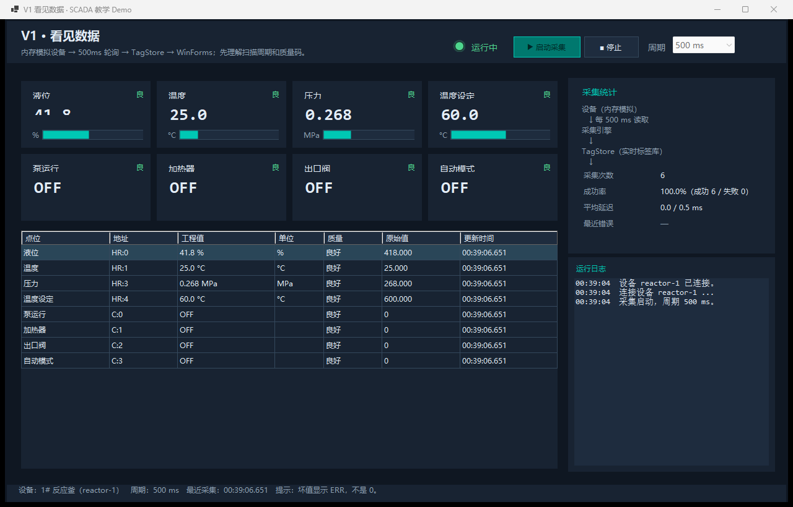
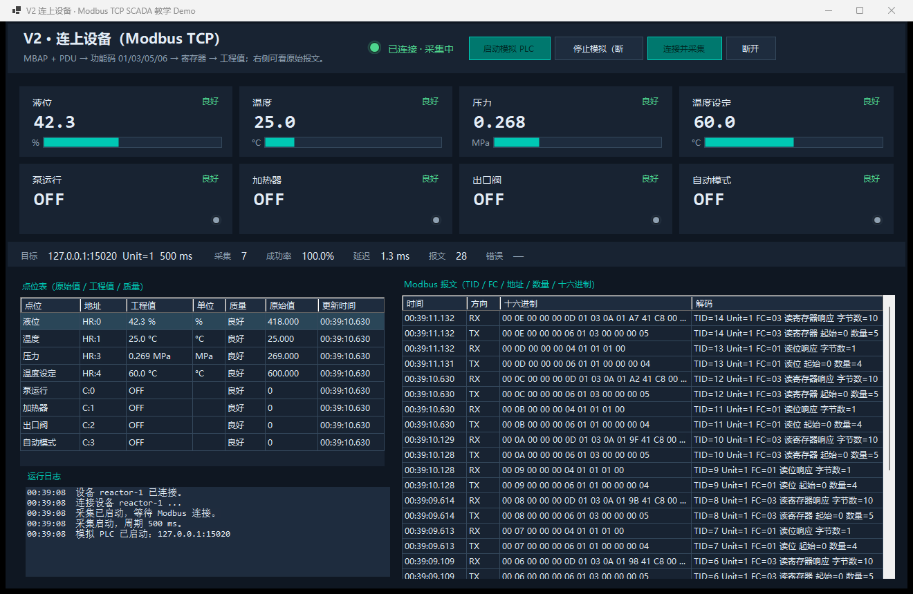
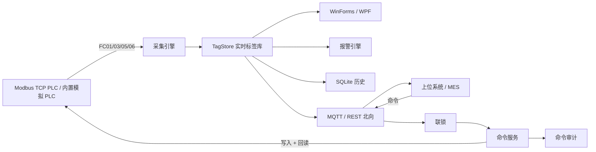

# 工控 SCADA 教学 Demo · WinForms + WPF

一套能直接运行的 SCADA 学习工程：用同一个“1# 反应釜”，在 **WinForms 和 WPF** 里各做 5 个版本，逐级演示：

> **看见数据 → 连上设备 → 数据可信 → 安全控制 → 上位联动**

不依赖真实 PLC，也不需要安装数据库/消息中间件：内置 Modbus TCP 模拟 PLC、SQLite 历史库、内嵌 MQTT Broker 和上位系统模拟器。



V2 的采集与原始报文：



---

## 3 分钟跑起来

### 环境

- Windows 10/11 x64
- .NET 10 SDK（本工程用 10.0.403 验证；`global.json` 允许 10.0.1xx 以上）
- 不需要 Visual Studio，命令行即可

```powershell
cd E:\Project\dsh\GongKongDemo
dotnet build ScadaDemo.sln -c Debug
dotnet run --project demos/WinForms/Scada.WinForms.V1.SeeData -c Debug
```

点“启动采集”，看液位/温度/压力滚动，再点“停止”。

也可以直接用脚本：

```powershell
scripts\run-v1.ps1                 # V1 WinForms
scripts\run-v2.ps1                 # V2 WinForms（内置模拟 PLC）
scripts\run-v3.ps1                 # V3 WinForms（注入故障看报警）
scripts\run-v4.ps1                 # V4 WinForms（联锁/回读/审计）
scripts\run-v5.ps1                 # V5 WinForms + 上位模拟器（REST + MQTT）
scripts\run-plc-simulator.ps1      # 只启动模拟 PLC，给 V2 或真实客户端连
```

WPF 版入口：

```powershell
dotnet run --project demos/Wpf/Scada.Wpf.V1.SeeData -c Debug
```

---

## 五个版本在学什么

| 版本 | 主题 | 关键新增 | WinForms | WPF | 导读 |
|---|---|---|---|---|---|
| V1 | 看见数据 | 内存模拟设备、扫描周期、TagStore、质量码、UI 线程封送 | `Scada.WinForms.V1.SeeData` | `Scada.Wpf.V1.SeeData` | [V1](docs/versions/V1.md) |
| V2 | 连上设备 | Modbus TCP、MBAP/PDU、寄存器映射、字节序、断线重连、原始报文 | `Scada.WinForms.V2.Modbus` | `Scada.Wpf.V2.Modbus` | [V2](docs/versions/V2.md) |
| V3 | 数据可信 | 四限报警、死区/延时/确认、SQLite 历史、趋势、故障注入 | `Scada.WinForms.V3.AlarmHistory` | `Scada.Wpf.V3.AlarmHistory` | [V3](docs/versions/V3.md) |
| V4 | 安全控制 | 联锁矩阵、写入、回读比对、审计、自动模式、急停 | `Scada.WinForms.V4.Control` | `Scada.Wpf.V4.Control` | [V4](docs/versions/V4.md) |
| V5 | 系统联动 | REST + MQTT、远程命令 ACK、内嵌 Broker 上位模拟器、断网补发 | `Scada.WinForms.V5.Northbound` | `Scada.Wpf.V5.Northbound` | [V5](docs/versions/V5.md) |

> 依赖关系本身就是课程：V1 只引用 `Scada.Core`；V2 才加入 `Scada.Protocol`；V3 加入 `Scada.Alarms`/`Scada.Storage`；V4 加入 `Scada.Control`；V5 加入 `Scada.Northbound`。前面的版本不会被后面的 MQTT/SQLite 代码污染。

---

## 统一被控对象

所有版本共用同一个反应釜和点位表：

| 点位 | 类型 | Modbus 地址 | 缩放 | 单位 | 说明 |
|---|---|---|---|---|---|
| 液位 `level` | uint16 | HR 0 | ×0.1 | % | 只读 |
| 温度 `temp` | float32 | HR 1–2 | ×1 | °C | 只读，ABCD |
| 压力 `pressure` | uint16 | HR 3 | ×0.001 | MPa | 只读 |
| 温度设定 `tempSetpoint` | uint16 | HR 4 | ×0.1 | °C | 可写 |
| 泵 `pump` | bool | Coil 0 | — | — | 可写 |
| 加热器 `heater` | bool | Coil 1 | — | — | 可写 |
| 出口阀 `valve` | bool | Coil 2 | — | — | 可写 |
| 自动模式 `autoMode` | bool | Coil 3 | — | — | 可写 |

模拟器内部还有设备侧保护：液位 <5% 强制停泵、<20% 强制关加热、>110°C 强制关加热。它与 V4 的 SCADA 联锁构成“双保险”。

---

## 架构



核心分层：

```text
Scada.Core        契约/点位/缩放/编解码/TagStore/工艺模型/采集引擎/配置/集成契约
Scada.Protocol    手写教学版 Modbus TCP 客户端 + 从站 + MBAP/PDU + 报文日志
Scada.Alarms      四限报警状态机（死区、延时、确认）
Scada.Storage     SQLite 历史 / 报警 / 命令审计
Scada.Control     联锁、命令服务、回读校验、审计事件
Scada.Northbound  Kestrel REST + MQTT 发布/订阅 + 离线缓存 + 协调器
Scada.UI.*        深色工业主题、状态灯、点位卡、无依赖趋势图
```

---

## 默认端口

| 服务 | 地址 | 说明 |
|---|---|---|
| Modbus 模拟 PLC | `127.0.0.1:15020` | 可在 `config/devices.json` 或启动参数改 |
| MQTT Broker | `127.0.0.1:18830` | 由上位模拟器内嵌启动 |
| REST API | `http://127.0.0.1:15080` | V5 内嵌 Kestrel |
| API Key | `scada-demo-token` | 仅演示，生产必须替换 |
| MQTT 主题 | `gongkong/line1/reactor/#` | telemetry / alarm / status / cmd / cmd/ack |

全部绑定本机，避免防火墙和 URL ACL 权限问题。

---

## 目录

```text
GongKongDemo/
├─ ScadaDemo.sln
├─ config/                 devices.json / northbound.json
├─ docs/                   基础概念、Modbus、报警、控制、北向、真实 PLC、FAQ
├─ scripts/                run-v1..v5、run-plc-simulator、verify
├─ src/                    6 个核心库 + 2 个 UI 库
├─ tools/                  Scada.PlcSimulator / Scada.UpperSystemMock
├─ demos/WinForms/         V1..V5
├─ demos/Wpf/              V1..V5
└─ tests/Scada.Tests/      64 个单元/集成测试
```

---

## 推荐学习顺序

1. 读 [SCADA 基础概念](docs/01-SCADA基础概念.md)，跑 V1。
2. 读 [Modbus TCP 入门](docs/03-ModbusTCP入门.md)，跑 V2，观察 TX/RX 报文。
3. 读 [报警与历史](docs/04-报警与历史.md)，跑 V3，注入超温故障。
4. 读 [控制与安全联锁](docs/05-控制与安全联锁.md)，跑 V4，尝试“低液位启泵”被拒。
5. 读 [上位系统联动](docs/06-上位系统联动.md)，跑 V5，观察 MQTT ACK 和 REST 写点。
6. 想接真实 PLC：按 [接入真实 PLC](docs/07-接入真实PLC.md) 的清单逐项核对。
7. 代码里的中文注释怎么读：看 [代码注释导读](docs/10-代码注释导读.md)。

完整路线与练习见 [学习路线](docs/00-学习路线.md)、[版本演进与代码导读](docs/02-版本演进与代码导读.md)。

---

## 验证

```powershell
dotnet test tests/Scada.Tests/Scada.Tests.csproj -c Debug
scripts\verify.ps1
```

`verify.ps1` 会构建、跑测试，并对 10 个 UI 依次执行 `--smoke` 自动验收；V5 还会先启动上位模拟器，验证 MQTT 命令 ACK 与 REST 写点。

当前验证结果：

- 64 个测试全部通过；
- 10 个 UI 冒烟全部通过；
- V5 端到端：18 条遥测、2 条 MQTT 命令 ACK、1 条 REST 写点、报警/历史齐全。

---

## 关于三个参考项目

本项目是**原创实现**，只借鉴了以下开源项目的架构模式，没有复制源码：

| 项目 | 借鉴点 | 许可证 |
|---|---|---|
| [NeoIndustrial](https://github.com/18354356258/NeoIndustrial) | WinForms 数采形态、模拟器驱动、四色报警、MQTT/DB 数据出口 | AGPL-3.0 |
| [twin-data-collector](https://github.com/agentthink/twin-data-collector) | 采集 → MQTT/DB/REST 的数据出口分层、零硬件模拟 | Apache-2.0（以仓库声明为准） |
| [iotgateway](https://github.com/keefer-yu/iotgateway) | 南向采集/写入、北向 MQTT/RPC、内置 Modbus Slave/MQTT Broker 的演示方式 | MIT |

详细分析、commit 与“哪些没照搬”见 [参考项目分析](docs/09-参考项目分析.md) 和 [THIRD_PARTY_NOTICES.md](THIRD_PARTY_NOTICES.md)。

---

## 这不是生产 SCADA

它是一个教学 Demo：单机、单设备、无用户权限、无冗余、无 IEC 62443、无 SIL。正式项目请使用成熟驱动库（NModbus/IoTClient 等）、工业级消息中间件、带审计与权限的 SCADA 平台，并按现场安全规范做联锁与验证。

