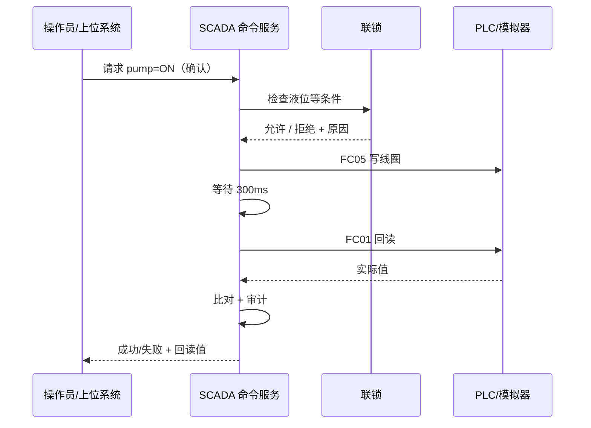

# 控制与安全联锁

## 1. 命令不是“发一帧就完事”



代码：`Scada.Control/CommandService.cs`。

## 2. 命令状态

```text
Pending → Validating → Writing → Verifying → Succeeded
                                      ├── Failed
                                      ├── Rejected
                                      └── Timeout
```

- **Rejected**：参数/联锁/确认不通过，没写设备。
- **Failed**：写失败或回读不一致。
- **Timeout**：命令超时。

## 3. 本项目的联锁

| 命令 | 规则 | 原因 |
|---|---|---|
| 启泵 | 液位 ≥ 10% | 防止泵干转 |
| 停泵 | 永远允许 | 安全方向 |
| 开加热器 | 液位 ≥ 30% | 防止干烧 |
| 开加热器 | 温度 < 95°C | 防止超温 |
| 开加热器 | 自动模式关闭 | 自动模式由设定值控制 |
| 开自动 | 设定值 30–95°C | 工艺窗口 |
| 开自动 | 液位 ≥ 30% | 自动加热安全 |
| 写设定值 | 30–95°C | 工艺窗口 |
| 急停 | 不检查联锁 | 按顺序停泵/加热/自动/关阀 |

代码：`Scada.Control/InterlockEngine.cs`。

## 4. 回读与容差

写成功后等待 300ms，再读同一个点：

- bool：必须完全一致；
- 数值：`|实际 - 请求| <= max(0.5, 1%)`。

回读不一致会判失败，而不是“写出去就算成功”。真实项目还要考虑 PLC 扫描周期、写入生效延迟、寄存器保持性。

## 5. 审计

每次命令都记录：

- 时间、来源（Local/Rest/Mqtt）
- 点位、请求值、回读值
- 成功/失败、原因、耗时

V4/V5 的“控制”页实时展示，同时写入 `command_audit` 表。上位系统出问题时，这张表能回答“谁在什么时候改了什么”。

## 6. 二次确认

关键命令（泵/加热/自动/设定值/急停）在 UI 弹确认框；REST/MQTT 远程命令由北向适配器验 Token 后以 `Confirmed=true` 进入命令服务。

演示 Token：`scada-demo-token`。生产必须换成真实鉴权、TLS、来源 IP/用户审计。

## 7. 急停

急停按顺序：

```text
pump=OFF → heater=OFF → autoMode=OFF → valve=CLOSE
```

每一项都走完整命令服务（写入 + 回读 + 审计），不是简单发四帧。这样即使中间某项失败，审计也能看到。

## 8. 自动模式的分工

本项目把自动温控放在**设备侧**：

- SCADA 写 `autoMode=1` 和 `tempSetpoint=75`
- 模拟器（代表 PLC）按 `tempSetpoint ±1°C` 控制加热器
- SCADA 手动开加热器在自动模式下被联锁拒绝

这是工业项目的常见分工：PID/联锁逻辑在 PLC，SCADA 只写设定值和模式，避免“上位机一断，控制就乱”。

## 9. 联锁 vs 设备保护

| 层 | 例子 | 作用 |
|---|---|---|
| SCADA 联锁 | 液位 <10% 拒绝启泵 | 不让危险命令发出 |
| 设备侧保护 | 液位 <5% 强制停泵 | 即使收到危险命令也不执行 |

两者必须同时存在。只做一层都不够安全。
