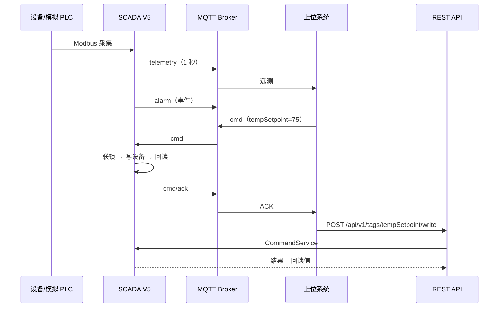

# 上位系统联动（REST + MQTT）

V5 把 SCADA 接到上位系统，提供两条通道；两条通道最终都进入同一个 `CommandService`，所以联锁、回读、审计只有一套。

## 1. 端到端时序



## 2. REST API

Base URL：`http://127.0.0.1:15080`
Header：`X-Api-Key: scada-demo-token`（`/health` 除外）

| 方法 | 路径 | 说明 |
|---|---|---|
| GET | `/api/v1/health` | 健康检查，无需 Token |
| GET | `/api/v1/tags` | 全部点位快照 |
| GET | `/api/v1/tags/{id}` | 单点 |
| POST | `/api/v1/tags/{id}/write` | 写点，body `{"value":75}` |
| GET | `/api/v1/alarms?active=true` | 活动报警；`active=false` 或省略为最近报警 |
| GET | `/api/v1/history?tagId=temp&minutes=10` | 历史 |
| GET | `/api/v1/commands` | 最近命令审计 |

### curl 示例

```bash
curl -H "X-Api-Key: scada-demo-token" http://127.0.0.1:15080/api/v1/tags

curl -X POST http://127.0.0.1:15080/api/v1/tags/tempSetpoint/write \
  -H "Content-Type: application/json" \
  -H "X-Api-Key: scada-demo-token" \
  -d '{"value":75}'

curl -H "X-Api-Key: scada-demo-token" \
  "http://127.0.0.1:15080/api/v1/history?tagId=temp&minutes=5"
```

### 返回码

- 200：成功
- 401：Token 缺失/错误
- 404：点位不存在
- 409：联锁拒绝
- 500：写失败/回读不一致

命令结果里包含 `State`、`Message`、`ActualValue`、`InterlockChecks`，上位系统可以据此显示原因。

## 3. MQTT

Broker 由上位模拟器内嵌启动：`127.0.0.1:18830`。

主题前缀：`gongkong/line1/reactor`

| 主题 | 方向 | 说明 |
|---|---|---|
| `.../telemetry` | SCADA → 上位 | 每秒全量快照 |
| `.../alarm` | SCADA → 上位 | 报警 raise/clear/ack |
| `.../status` | SCADA → 上位 | online/offline（retained/LWT） |
| `.../cmd` | 上位 → SCADA | 远程命令 |
| `.../cmd/ack` | SCADA → 上位 | 命令结果 |

### telemetry

```json
{
  "Timestamp": "2026-11-02T16:31:05+00:00",
  "DeviceId": "reactor-1",
  "DeviceName": "1# 反应釜",
  "Sequence": 42,
  "Values": [
    { "Id": "temp", "Name": "温度", "Value": 72.3, "Unit": "°C", "Quality": "Good", "Raw": 72.3 }
  ]
}
```

### cmd

```json
{
  "Id": "4f2c...",
  "TagId": "tempSetpoint",
  "Value": 75,
  "Token": "scada-demo-token",
  "Source": "UpperSystemMock"
}
```

### cmd/ack

```json
{
  "Id": "4f2c...",
  "TagId": "tempSetpoint",
  "Ok": true,
  "State": "Succeeded",
  "Message": "命令成功，回读 75.0 °C。",
  "ActualValue": 75,
  "Timestamp": "2026-11-02T16:31:05+00:00"
}
```

## 4. 断网补发

`OfflineBuffer` 在 MQTT 不可用时把 `topic + payload` 追加到 `data/mqtt-outbox.jsonl`，连接恢复后按顺序重发。

- 上限默认 10000 条；
- 发布失败/连接断开都会入队；
- V5 的“北向”页显示“待补发”数量；
- 生产环境应使用持久化队列、幂等键、ACK 确认与死信。

## 5. 上位模拟器

`tools/Scada.UpperSystemMock`：

- 启动内嵌 MQTT Broker（18830）
- 订阅 `gongkong/line1/reactor/#`
- 打印遥测/报警/ACK
- 自动模式：3 秒后 MQTT 改设定值，6 秒后启泵，9 秒后调 REST
- `--auto --duration 8` 用于自动验收

```powershell
scripts\run-v5.ps1
```

脚本会先启动上位模拟器，再启动 V5。

## 6. 安全提醒

演示 Token 是明文、Broker 无认证、REST 无 TLS。生产必须：

- 每个系统独立凭证，禁止共享 Token；
- MQTT over TLS + 账号/ACL；
- REST HTTPS + 鉴权 + 限流；
- 命令幂等、重放保护、审计与告警；
- 网络分区/白名单。
